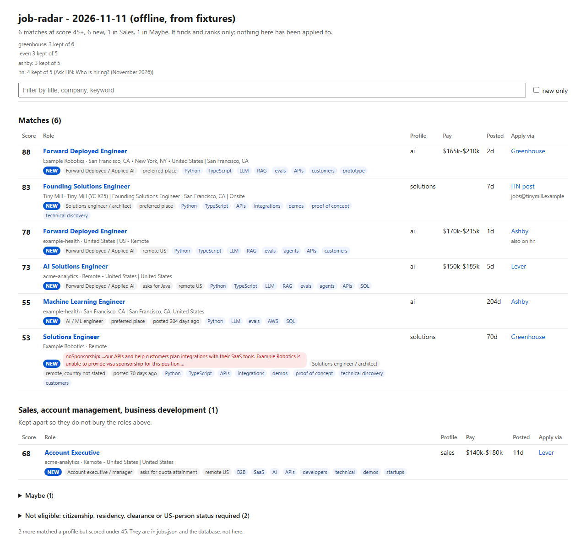

# job-radar

[](https://github.com/mattniznik/job-radar/actions/workflows/ci.yml)  [](LICENSE)



A config-driven job finder. It reads public company job boards (Greenhouse, Lever, Ashby) and
the monthly Hacker News "Who is hiring?" thread, keeps the postings that match the roles you
describe in one YAML file, scores how well each one fits, flags postings that require
citizenship or a clearance or say they will not sponsor a visa, and writes an HTML report, a
JSON file and a SQLite database. It finds and ranks. It never applies.

I run a version of this every morning for my own search; this is the general part of it.


The picture is [docs/sample-report.html](docs/sample-report.html), built offline from the
fictional postings in `fixtures/` (GitHub shows HTML as source, so open it locally to click
around).

## Why it stops short of applying

- **The boards do not offer it.** Reading postings from Greenhouse, Lever and Ashby is public
  and needs no key. Submitting an application is not: both Greenhouse's Job Board API and
  Lever's postings API need the employer's own API key to post one, and Greenhouse says its
  hosted application form has spam protection and fraud-detection checks. Lever's docs say its
  published postings "may be scraped by third parties"; they say nothing like that about
  applying. (Checked against both vendors' docs in November 2026.)
- **An application is yours.** It goes out under your name, answers screening questions about
  your work authorization, and is read by a person. A wrong or careless one costs more than the
  minute it would save. So the tool does the reading and sorting, and you decide what to send.

## How it works

```text
boards + HN  ->  title and place filter  ->  dedupe  ->  work-auth check  ->  score  ->  lanes
```

1. **Read.** Each board is one public API call (Greenhouse is two: the list has no
   descriptions, so only postings that pass the title and place filter get their description
   read). A board that fails is listed in the report with its error. It never stops the run.
2. **Filter.** A title has to match one of your `profiles`, must not match `skipTitles`, and
   must not be a `drop` type. The place has to be local to you or remote with a US option.
   A title that names another city or region ("Forward Deployed Engineer (Atlanta, Georgia)")
   is a job based there, so it is dropped unless the posting is local anyway.
3. **Dedupe.** One role is one company plus one title, ignoring case and punctuation. When
   the same role shows up on a company board and on Hacker News, the company board wins (it
   is the real application form) and the report says where else it was listed.
4. **Check work authorization.** Patterns in `workAuth` run over the full posting text.
   A `block` match moves the posting to "Not eligible"; a `flag` match keeps it in its lane,
   marked red. Both show the sentence that matched, so a false positive is easy to spot.
   Patterns match whole words only, so `ITAR` does not fire on "military" in an equal
   opportunity footer.
5. **Score and sort into lanes.**

### Lanes

| Lane | What lands there |
| --- | --- |
| Matches | `keep` types at or above `minScore` |
| Sales | `sales` types at or above `minScore`, kept apart so they do not bury the main list |
| Maybe | `maybe` types, and any title no type row catches, at or above `minScore` (folded) |
| Not eligible | a `workAuth.block` pattern matched, whatever the score (folded, with the sentence) |
| under the score | counted in the report, kept in `jobs.json` and the database, not listed |

### Scoring

Keyword hits carry most of the score, so a posting in the right place that says nothing about
your kind of work stays low. The weights live in `WEIGHTS` in [src/rules.mjs](src/rules.mjs):

| Signal | Points |
| --- | --- |
| title matched a profile | +10 |
| each profile `keyword` found in the posting | +8, up to +48 |
| each profile `avoid` word found | -5, down to -15 |
| place: `preferred` / other local / remote US / remote with no country | +25 / +15 / +15 / +5 |
| posted in the last 7 days | +5 |
| open more than 45 days / more than 180 days | -10 / -20 |
| posted pay tops out under `salaryFloor` (hourly x 2080) | -25 |

The score is clamped to 0-100, and every adjustment shows as a chip on the posting, so you can
see why it ranked where it did. With these weights a remote US posting with three keyword hits
scores 10 + 3 x 8 + 15 = 49.

### "New" means new

`seen.json` is a first-seen ledger keyed by company and title. A posting is marked NEW the first
day it lists, and only listed postings go in, so one that was under the score yesterday is
still new the day it clears it.

## Quick start

Node 22.17 or newer, which is what it is tested on. It uses the built-in `node:sqlite`, which
some earlier 22.x releases only enable behind a flag. One dependency, `yaml`.

```sh
npm install

# Offline: the bundled fixtures instead of the network. Writes output/offline/report.html
npm run offline

# Live: copy the example, make it yours, run it
cp radar.example.yaml radar.yaml
npm start                                   # reads ./radar.yaml, writes ./output
node bin/radar.mjs --config other.yaml --out runs/today
```

Flags: `--offline`, `--config <file>`, `--out <dir>`, `--today YYYY-MM-DD` (pins the date and
the clock the score uses), `--report <file>` (also write the HTML there). `npm run sample`
rebuilds `docs/sample-report.html`.

The last line of output is a one-line JSON summary, so a scheduler or another script can read
the result. A run where every source failed writes nothing and exits 1, so a day without
internet does not replace the last good report with an empty one.

Node 22 marks `node:sqlite` as experimental and prints one `ExperimentalWarning` when it loads.

## Config reference

Everything is in one file. [radar.example.yaml](radar.example.yaml) has a comment on every
setting; this is the summary. "Words" match whole words, case-insensitive. "Regex" is a
JavaScript regular expression, case-insensitive. An empty list always matches nothing.

| Key | Type | What it does |
| --- | --- | --- |
| `profiles.<name>.titles` | words | a title must match one profile to be read; first match wins |
| `profiles.<name>.keywords` | words | counted in the posting text for the score |
| `profiles.<name>.avoid` | words | count against the posting |
| `skipTitles` | words | dropped even when a profile matches (seniority, unrelated roles) |
| `types[]` | `{ name, tier, titles: [regex] }` | sorts a title into `keep`, `sales`, `maybe` or `drop`; first match wins |
| `location.places` | words | the cities you would commute to |
| `location.preferred` | words | the subset that scores +25 instead of +15 |
| `location.region` | words, case as written | the state words a place must sit beside ("Oakland, CA") |
| `location.bare` | words | places that count alone when no other state or country is named |
| `location.elsewhere` | words | a title naming one of these is dropped unless the posting is local |
| `location.remote` | true / false | false keeps local postings only |
| `minScore` | number | listed at or above this |
| `salaryFloor` | number | yearly; 0 turns the pay check off |
| `workAuth.block.<kind>` | [regex] | moves a posting to Not eligible |
| `workAuth.flag.<kind>` | [regex] | marks a posting red, keeps it in its lane |
| `boards.greenhouse` / `lever` / `ashby` | tokens | the token in `job-boards.greenhouse.io/<token>`, `jobs.lever.co/<token>`, `jobs.ashbyhq.com/<token>` |
| `hackernews` | true / false | read the newest "Who is hiring?" thread |

## Output

Each run writes into `--out` (default `output/`):

| File | What it holds |
| --- | --- |
| `report.html` | the report: one self-contained page with a filter box and a "new only" switch |
| `jobs.json` | the run summary and every role that passed the title and place filter (after dedupe), with its lane, score, reasons and flags (descriptions left out to keep it small) |
| `seen.json` | the first-seen ledger |
| `radar.db` | SQLite: every run, with descriptions |

`radar.db` has `postings` (one row per posting, with first and last day seen and its best score),
`sightings` (its lane and score on each run), `runs`, a full-text index `postings_fts` over title,
company and description, and a `latest_run` view. It uses WAL mode and a busy timeout, so
[Datasette](https://datasette.io/) can browse it while a run writes:

```sh
pip install datasette
datasette output/radar.db
```

## Tests

```sh
npm test
```

`node --test` with no extra framework. The fixtures in `fixtures/` are small, made-up postings at
fictional companies (Example Robotics, Acme Analytics, Example Health, Tiny Mill), written by hand
in the shape of each API's real response. The tests cover the rules on their own (title types,
place, work-auth sentences, every score weight against a pinned clock), each fetcher against its
fixture, dedupe and the ledger, and whole runs into a temp folder: the files written, two days of
ledger and database, and the run that reads nothing and must write nothing. The fetchers take a
`get` function, which in the tests reads the fixtures folder, and the whole-run tests also
replace `fetch` with one that fails the test, so no test reaches the network.

## Limits

- The remote check is written for a US search: "remote" counts when it names the US or no
  country at all. A search based elsewhere needs the country lists in `src/rules.mjs` changed.
- Lever and Ashby responses do not carry the company name in the fields this reads, so the board
  token stands in for it.
- Hacker News is the newest "Who is hiring?" thread only, and a post's role is the first part of
  its header line that matches a profile.
- Not included: sources that need a paid key, and sites whose terms bar automated access.

## License

MIT, see [LICENSE](LICENSE).
